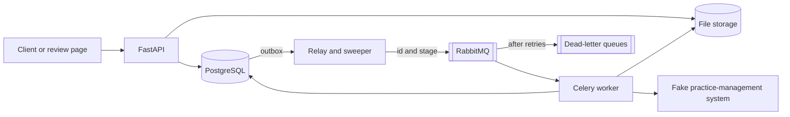
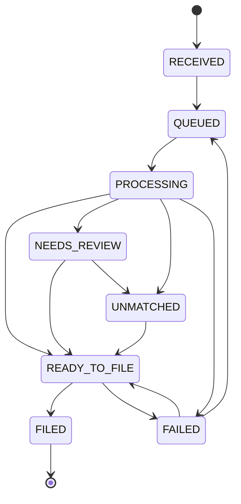

# Mailroom

Document intake and case matching for a fictional law firm. All documents and data are
synthetic. This is a three-day learning project and is not production-ready.

## The problem

A law firm receives a steady stream of documents that must end up on the right matter. Filing
one on the wrong matter is expensive, and at-least-once message delivery means the same work
can run twice. Mailroom shows how to automate the clear cases, send doubtful ones to a person,
and avoid filing a document twice, even when workers crash.

## Architecture

A modular monolith: one Python package with separate API, relay and worker processes, and one
React page. PostgreSQL is the source of truth. RabbitMQ carries only a document id and a stage.



A document moves through extract, classify, match and decide. A confident match goes on to
filing. Anything else waits for a person.



The two transitions out of `FAILED` exist in the state machine, but nothing uses them yet.

## Five-minute setup

You need Docker with Compose v2 and `make`. The review page also needs Node, and `make drills`
needs Python 3 on the host. Everything else runs in containers.

1. Create your local configuration, then change both passwords in `.env`. Use letters, digits
   and hyphens only, because passwords are placed inside connection URLs.

   ```bash
   cp .env.example .env
   ```

2. Start the stack, load fictional data, and run sample documents through it. The first run
   prints an API key once. Keep it for the review page, because only its hash is stored.

   ```bash
   make demo
   ```

3. Open the review page at <http://127.0.0.1:5173> and enter the key.

   ```bash
   make web
   ```

4. Stop everything when you're done. This keeps your data.

   ```bash
   make down
   ```

A guided walkthrough with exact commands is in [docs/DEMO.md](docs/DEMO.md).

## Commands

| Command | What it does |
|---|---|
| `make up` | Build and start the API, relay, worker and their dependencies |
| `make down` | Stop everything and keep the data |
| `make migrate` | Apply database migrations |
| `make seed` | Load fictional data, safe to repeat |
| `make demo` | Start the stack, seed it, check health and upload samples |
| `make web` | Run the review page against the local API |
| `make test` | Run all tests against real PostgreSQL and RabbitMQ |
| `make lint` | Run Ruff and strict mypy |
| `make evaluate` | Regenerate [docs/EVALUATION.md](docs/EVALUATION.md) from a fixed seed |
| `make drills` | Inject real failures and write [docs/DRILLS.md](docs/DRILLS.md) |

To delete local data as well:

```bash
docker compose down -v
```

## Testing

`make test` uses a separate Compose project, because the suite truncates tables and purges
queues. It can't touch your development data, but two runs at once collide with each other.
Pass pytest options with `ARGS`:

```bash
make test ARGS='tests/unit -q'
```

`make drills` also uses its own project and removes it afterwards. Each drill defines the
expected behaviour, how the failure is injected, the evidence and the assertions, and checks
Postgres and RabbitMQ directly. The last run is recorded in [docs/DRILLS.md](docs/DRILLS.md).

## How a document is decided

A document must clear every check below before automatic filing:

| Situation | Result | Reason |
|---|---|---|
| A PDF with no text layer | `NEEDS_REVIEW` | `NEEDS_OCR` |
| Unreadable, encrypted or empty | `NEEDS_REVIEW` | `CORRUPT_DOCUMENT`, `ENCRYPTED_DOCUMENT`, `EMPTY_DOCUMENT` |
| Over the page or text limit | `NEEDS_REVIEW` | `DOCUMENT_TOO_LARGE` |
| Two different matters or clients named | `NEEDS_REVIEW` | `CONFLICTING_MARKERS` |
| Classifier confidence below 0.70 | `NEEDS_REVIEW` | `LOW_CONFIDENCE` |
| No candidate with real evidence | `UNMATCHED` | `NO_CANDIDATE` |
| Best candidate's matter is closed | `NEEDS_REVIEW` | `MATTER_CLOSED` |
| Score below 0.90, or a lead below 0.15 | `NEEDS_REVIEW` | `AMBIGUOUS_MATCH` |
| Otherwise | `READY_TO_FILE`, then `FILED` | |

The match score is a weighted sum: case number 0.55, party name 0.30, date 0.15. A case number
and matching client together are needed to reach 0.90, so neither is enough alone. These
thresholds are starting points, not validated values. The measured trade-off between automation
and errors is in [docs/EVALUATION.md](docs/EVALUATION.md), on synthetic data only.

## API

All routes except the health checks need an `X-API-Key` header. The tenant comes from the key,
and another tenant's document looks like a missing one.

| Route | Purpose |
|---|---|
| `GET /healthz` | The process is alive. Checks no dependency |
| `GET /readyz` | PostgreSQL and RabbitMQ respond within 2 seconds, otherwise 503 |
| `POST /documents` | Upload a PDF or text file. 202 if new, 200 if a repeat |
| `GET /documents/{id}` | Current state |
| `GET /documents/{id}/events` | Audit trail |
| `GET /reviews` | Documents waiting for a person |
| `GET /reviews/{id}` | Fields, classification, candidates and history |
| `POST /reviews/{id}/resolve` | `APPROVE`, `ASSIGN` or `MARK_UNMATCHED`, with optional corrections |
| `GET /matters?q=` | Search matters to assign |

`resolve` needs the `expected_version` the reviewer saw. If the document changed since then, it
returns 409 and changes nothing, so two reviewers can't overwrite each other.

## Filing

Filing has three steps: `CREATE_RECORD`, `ATTACH_DOCUMENT` and `CONFIRM`. Each has its own
idempotency key, stored the first time the step runs, and its progress commits on its own. A
retry resumes at the first incomplete step.

No database lock is held during an external call. A call can therefore repeat, after a crash, a
timeout or a duplicate message. That repeat is safe only because the receiver deduplicates on
the key, so a timeout after a successful call can't produce a second filing. A real system would
have to offer the same promise. The fake one can inject faults with `FAKE_DMS_FAULTS`, for
example `CONFIRM:timeout_after:1`.

## Reliability

Delivery is at-least-once. Nothing here is exactly-once: a queue and a database can't commit
together. Instead, repeated delivery has no further effect:

1. **A committed dispatch survives.** A document and its outbox row commit in one transaction,
   so neither exists without the other. The row stays pending until the broker confirms it,
   however long that takes.
2. **A dispatch may be sent twice.** A crash between the broker's confirm and the commit sends
   the message again. Duplicates are safe and lost messages are not.
3. **A duplicate does nothing.** Each delivery locks the document and checks it against Postgres.
   A message that is no longer current is a logged no-op.
4. **A stage is all or nothing.** Its results, its state change and the next outbox row commit
   together. If a worker dies, Postgres rolls back, the broker redelivers, and the attempt count
   stops a poison document from looping forever.
5. **A lost message is recovered.** The sweeper re-dispatches any active document that has
   stopped moving for two minutes. It may add duplicates, which do nothing.
6. **Failures end somewhere visible.** Transient errors retry three times with backoff, then the
   document moves to `FAILED` with a reason and the message goes to that stage's dead-letter
   queue. Unexpected errors skip the retries, because a bug fails the same way every time.
   Undecodable messages are dead-lettered unread.
7. **Stuck processes end.** A stage is killed after 60 seconds. A database statement is cancelled
   after 30. A relay pass that hangs exits after 60, its locks are released, and Compose starts it
   again.

What fails, and how it behaves, is in [docs/FAILURE_MODES.md](docs/FAILURE_MODES.md).

## Built, and designed only

**Built:**

- Authenticated, tenant-scoped upload of PDF and plain text
- Centralized state machine, transactional outbox, relay and sweeper
- Text extraction, a rule-based classifier, field extraction and an explainable matcher
- A review API with optimistic concurrency, and one React page
- Idempotent, resumable filing into a fake practice-management system
- An append-only audit trail, a seeded evaluation and failure drills

**Designed, not built:** row-level security, OCR, an LLM classifier, signed webhooks, metrics
dashboards, a load test and multi-document splitting.

## Known limitations

- `FAILED` documents have no retry route, and re-uploading returns the same document.
- Dead-lettered messages are kept for inspection, but nothing replays them.
- Filing goes to a fake system only. A real one must deduplicate on the idempotency key.
- The classifier and thresholds are measured on synthetic data, so real accuracy is unknown.
- A corrected case number is stored and audited, but the document is not matched again.
- The review page shows the oldest 50 items, with no paging.
- It runs on one host, with files on a shared Docker volume.

Security assumptions and accepted risks are in [docs/SECURITY.md](docs/SECURITY.md), and the main
decisions are recorded in [docs/adr](docs/adr).

## Configuration

Compose reads `.env`, and `.env.example` lists the values you must set. Optional tuning values and
their defaults are in `src/mailroom/config.py`. No secrets belong in the repository. `/docs` and
`/openapi.json` are off unless `API_DOCS_ENABLED=true`.

Application logs are one JSON object per line. Extra fields pass through an allowlist, and
exceptions keep only their type and location, so document contents and credentials stay out of
logs. A few lines are plain text and carry no document data: Celery's shutdown notice, and the
stack dump when a relay pass hits its deadline.
